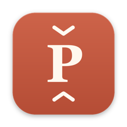

<h1 align="center">Pressa</h1>

<em>Make any file fit the size you need, and turn files into the format you need.</em>

<a href="https://github.com/Przem3kG/Pressa-downloads/releases/latest/download/Pressa.dmg"><b>⬇ Download Pressa for Mac</b></a>

## What it does

- **Compress:** drop in a photo, PDF, Word, Excel or PowerPoint file, choose the size you need (e.g. under 2 MB for an upload form), and Pressa keeps the best quality that fits. Your original is never changed.
- **Convert:** photos to JPEG, PNG, WebP or HEIC; several photos into one PDF; PDF pages to images.

## Requirements

A Mac with Apple Silicon (M1 or newer) running macOS 12 or later.

## How to install

1. Download **Pressa.dmg** using the link above, and open it.
2. Drag **Pressa** onto the **Applications** folder.
3. Open Pressa from Applications. The first time, macOS will say it can't verify the app, because Pressa isn't from the App Store. To open it anyway:
   - Click **Done** in that message.
   - Open **System Settings → Privacy & Security**, scroll down and click **Open Anyway** next to "Pressa was blocked".
   - Confirm with **Open Anyway** and your password.

   You only need to do this once.
